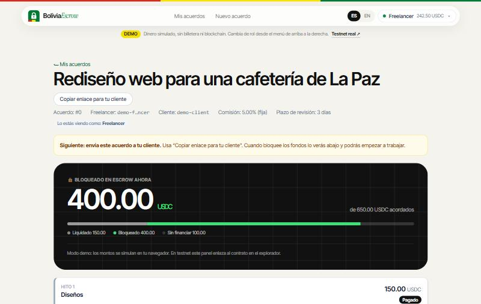
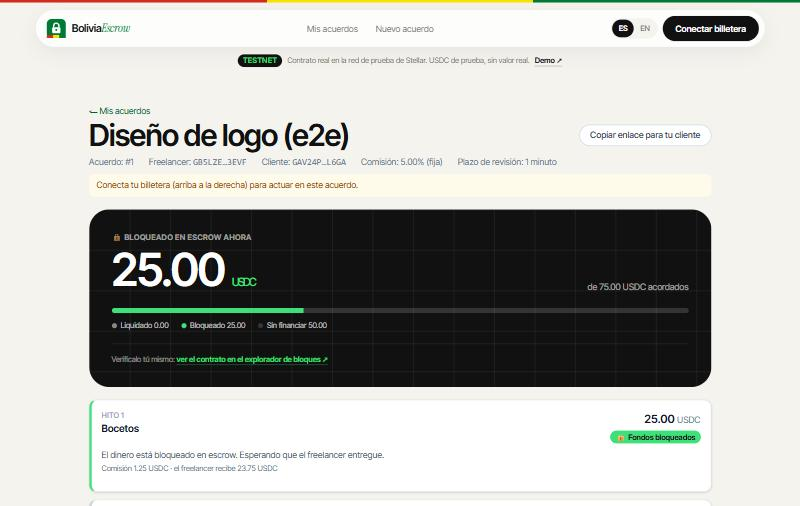

<div align="center">


# Bolivia Escrow

**See your client's money locked before you start working.**

Milestone escrow on Stellar for Bolivian freelancers who bring their own clients.

**[Live app](https://bolivia-escrow.vercel.app)** · [Contract on testnet](https://stellar.expert/explorer/testnet/contract/CDG4IJBASV35CIFBJ66O6HGCV3VWCLDKHCHAXS2QZFLXRKGP4LRNW2LO) · [Demo script](docs/demo-script.md) · [How the contract works](docs/contract.md)

</div>

> **🇧🇴 En español:** Bolivia Escrow permite que un freelancer boliviano vea el dinero de su cliente
> bloqueado en un contrato inteligente de Stellar **antes** de empezar a trabajar. El cliente bloquea
> USDC por cada hito; el pago se libera cuando aprueba, automáticamente si no responde dentro del plazo,
> o lo divide un árbitro si hay disputa. Comisión fija del 5%. La app está en español por defecto.


## The problem

Bolivian freelancers working for clients at home or abroad:

1. **Can't see the money.** They start work with no proof the client can pay.
2. **Depend on goodwill.** Getting paid depends on the client, or on a platform's rules they can't check.
3. **Pay for what they don't use.** Marketplace fees pay for finding the client, even when the freelancer brought their own.

## How it works

1. The **freelancer** creates an agreement with 1 to 10 milestones and sends the link to the client.
2. The **client** locks USDC for a milestone in the Soroban contract.
3. The freelancer **sees the locked money on-chain** and only then starts working.
4. The freelancer submits a link to the work. The milestone is then paid when one of these happens:
   - the client **approves** it,
   - the review window ends with no answer, and the freelancer **claims** it,
   - the client **disputes** it, and an **arbiter** splits the amount between both sides.

Nobody can change the rules after creation, not even the platform. Once money is locked, only the freelancer can send it back to the client. The 5% fee is shown up front and frozen into each agreement.

| Agreement: money locked and status per milestone | Live review countdown and "your turn" actions |
|---|---|
|  |  |
| **Dashboard** | **Real agreement read from the testnet contract** |
|  |  |

## Why Stellar

With a database, the platform holds the money and everyone has to trust the platform. With a Soroban contract, the money sits in a public contract whose rules can't change. **The freelancer can verify the funds themselves on a block explorer.** That "see the money" promise only exists because of the chain, and cheap USDC settlement on Stellar is what keeps the fee small.

**Built with:** Soroban (Rust) · USDC as a Stellar Asset Contract · Stellar Wallets Kit (Freighter, xBull, Albedo, LOBSTR, Hana, Rabet) · Stellar SDK generated contract bindings · Friendbot · Next.js + TypeScript + Tailwind.

## Live on testnet

| | |
|---|---|
| Escrow contract | [`CDG4IJBA…NW2LO`](https://stellar.expert/explorer/testnet/contract/CDG4IJBASV35CIFBJ66O6HGCV3VWCLDKHCHAXS2QZFLXRKGP4LRNW2LO) |
| Test USDC | [`CAHWJDBZ…DXR2`](https://stellar.expert/explorer/testnet/contract/CAHWJDBZVQCKB3J5PLBQKJJJLG4BDYANSK4JTAMS2TYEKWRLQZFYDXR2) (our own test asset, no real value) |
| Test-USDC faucet | [`CB74EKQ5…VO3O`](https://stellar.expert/explorer/testnet/contract/CB74EKQ5HJBY7NF277QJIQHI7W4QA6IOAPXW2ALSBV2GTTRE5VOXVO3O) (1,000 test USDC per account per day, signed by the user) |
| Fee | 5% |

On-chain test: the client locked 100 USDC ([tx](https://stellar.expert/explorer/testnet/tx/e662fa8f39ac084cf8ca0efc32de1ea288a47ea0cffc33049ed2f7554d9cad81)). On approval the contract paid **95 to the freelancer and 5 as the fee** ([tx](https://stellar.expert/explorer/testnet/tx/ebc36775d597b210d0abd29ec1a6b057928ac0caa52c571f3971261ca795c37a)).

## Try it

Open **https://bolivia-escrow.vercel.app**, or run it locally:

```bash
git clone https://github.com/JulioGB01/bolivian_freelancer_platform.git
cd bolivian_freelancer_platform
npm install
npm run dev        # http://localhost:3000
```

- **Demo mode** (the default) needs no wallet. Switch between Freelancer, Client and Arbiter from the menu at the top right.
- **Testnet mode:** click **→ Testnet real** in the banner and connect Freighter (set to Testnet). In the wallet menu, get test XLM, enable USDC, then get 1,000 test USDC.

The **ES / EN** button switches the language.

## Repository

```
src/          web app (Next.js): pages, components, escrow client, wallet, translations
contracts/    Soroban contracts in Rust: escrow (20 unit tests) and a test-USDC faucet
scripts/      testnet deploy, on-chain smoke test, checks
deployments/  deployed contract ids
docs/         product, architecture, contract, testing, demo script
```

```bash
cd contracts && cargo test     # contract tests
bash scripts/deploy-testnet.sh # deploy your own copy (needs the Stellar CLI)
```

CI runs the contract tests and the web build on every push.

## Roadmap

- Pay in and cash out in bolivianos through Pollar (bank QR to USDC).
- Interviews with freelancers and clients, and a legal review of the payments licence under ASFI.
- Mainnet with Circle USDC.

<div align="center"><sub>Made for Bolivian freelancers 🇧🇴 · National Startups Hackathon 2026 by Stellar</sub></div>
