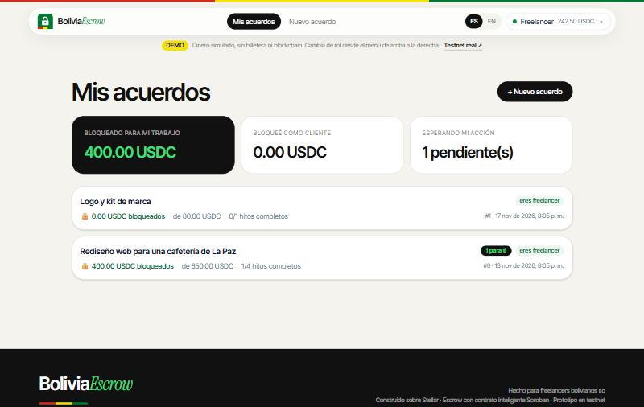

<div align="center">


# Bolivia Escrow

**See your client's money locked before you start working.**

Non-custodial milestone escrow on Stellar for Bolivian freelancers who bring their own clients.

**[Live app](https://bolivia-escrow.vercel.app)** · [Contract on testnet](https://stellar.expert/explorer/testnet/contract/CAF4G4ACGMDYLPYPPGMVKTL3FTHVTKOR4OTD7YE5CQWCQ5X327E3DOUO) · [Demo script](docs/demo-script.md) · [How the contract works](docs/contract.md) · [Concept Audit & SCF Roadmap (ES)](docs/CONCEPT_AUDIT_AND_SCF_ROADMAP.md)

</div>

> **🇧🇴 En español:** Bolivia Escrow permite que un freelancer boliviano vea el dinero de su cliente
> bloqueado en un contrato inteligente de Stellar **antes** de empezar a trabajar. El cliente bloquea
> USDC por cada hito; el pago se libera cuando aprueba, automáticamente si no responde dentro del plazo,
> o lo divide un árbitro si hay disputa. **Comisión fija del 1.5% (`150 bps`)**, congelada en cada acuerdo.
> Al cobrar, el freelancer puede pasar a **BOB vía Pollar (QR Simple)**, ahorrar en USDC con **Vaquita** y descargar su **comprobante de pago (SIAT)**. La app está en español por defecto.


## The problem

Bolivian freelancers working for clients at home or abroad:

1. **Can't see the money.** They start work with no proof the client can pay.
2. **Depend on goodwill.** Getting paid depends on the client, or on a platform's rules they can't check.
3. **Pay for what they don't use.** Marketplace fees (5–10%) pay for finding the client, even when the freelancer brought their own.

## How it works

1. The **freelancer** creates an agreement with 1 to 10 milestones and sends the link to the client.
2. The **client** locks USDC for a milestone in the Soroban contract.
3. The freelancer **sees the locked money on-chain** (`/verificar/[id]` or Stellar Expert) and only then starts working.
4. The freelancer submits a link to the work. The milestone settles when one of these happens:
   - the client **approves** it,
   - the review window (1h–30d) ends with no answer, and the freelancer **claims** it automatically,
   - the client **disputes** it (while `Submitted` within the review window, or while `Funded` if the freelancer ghosts), and the agreement's pinned **arbiter** splits the amount between both sides.
5. **Cash out & proof:** once USDC is released, the freelancer can convert to bolivianos via **Pollar (QR Simple)**, save in USDC via **Vaquita**, and download a **payment receipt (SIAT / bank proof)**.

**Non-custodial & rule-locked:** Nobody can change an agreement's rules after creation, not even the platform admin. Each agreement snapshots its **`fee_bps` (1.5% / `150 bps`)**, **`arbiter`**, and **`fee_recipient`** at creation time, with ~30-day Soroban storage TTL renewal on every state change. Once money is locked, the client can never unilaterally pull it back; only the freelancer can refund, or the pinned arbiter can split a formal dispute.

| Agreement: money locked and status per milestone | Live review countdown and "your turn" actions |
|---|---|
|  |  |
| **Dashboard** | **Real agreement read from the testnet contract** |
|  |  |

## Site structure

| Part | Path | For |
|---|---|---|
| Website | `/`, `/como-funciona` | Value prop, live on-chain totals, comparison (1.5% vs Upwork / Trustless Work / direct QR), FAQ |
| Public proof | `/verificar/[id]` | Anyone: locked money, pinned arbiter/fee, milestone status and on-chain activity, no wallet |
| Freelancer profile | `/perfil/[address]` | Public track record computed from the contract: paid & resolved milestones, earned, disputes, level |
| App entry | `/app` | Main workspace entry with role tabs and demo/testnet switcher |
| Freelancer area | `/app/freelancer`, `/app/nuevo` | Create agreements, share the link, deliver, claim, off-ramp via Pollar & download SIAT receipt |
| Client area | `/app/cliente` | Proposals to accept, agreements in progress, approve or dispute |
| Arbiter area | `/app/arbitro` | Split disputed milestones (`Funded` or `Submitted`) |
| Agreement | `/app/acuerdo/[id]` | Tabs: Summary · Activity · Details. A client sees a guided invitation first |
| Wallet | `/app/billetera` | Test XLM (Friendbot), USDC trustline, test-USDC faucet |

Every money action opens a **review** (amount, 1.5% fee, who gets what) before the wallet signs, and ends with a **receipt** linking to the transaction. The **activity timeline** is read from the contract's events on Stellar.

## Why Stellar & Ecosystem Integration

With a database, the platform holds the money and everyone has to trust the platform (and in Bolivia, holding third-party funds triggers ASFI financial intermediation / ETF licensing). With a Soroban contract, the money sits in a **non-custodial** public contract whose rules can't change. **The freelancer can verify the funds themselves on a block explorer.**

- **Soroban (Rust) + USDC SAC:** Deterministic milestone settlement with 1.5% (`150 bps`) fee.
- **Pollar (BOB off-ramp):** Post-release handoff and live BOB/USDC parallel-rate preview to withdraw to any Bolivian bank via QR Simple.
- **Vaquita:** Post-release savings CTA to keep unused USDC earning yield on Stellar.
- **Stellar Wallets Kit:** Freighter, xBull, Albedo, LOBSTR, Hana, and Rabet support.

**Built with:** Soroban (Rust, `soroban-sdk` 28.0.0) · USDC as a Stellar Asset Contract · Stellar Wallets Kit · Stellar SDK generated contract bindings · Friendbot · Next.js + TypeScript + Tailwind + Vitest.

## Live on testnet

| | |
|---|---|
| Escrow contract | [`CAF4G4AC…DOUO`](https://stellar.expert/explorer/testnet/contract/CAF4G4ACGMDYLPYPPGMVKTL3FTHVTKOR4OTD7YE5CQWCQ5X327E3DOUO) |
| Test USDC | [`CAHWJDBZ…DXR2`](https://stellar.expert/explorer/testnet/contract/CAHWJDBZVQCKB3J5PLBQKJJJLG4BDYANSK4JTAMS2TYEKWRLQZFYDXR2) (test asset, no real value) |
| Test-USDC faucet | [`CB74EKQ5…VO3O`](https://stellar.expert/explorer/testnet/contract/CB74EKQ5HJBY7NF277QJIQHI7W4QA6IOAPXW2ALSBV2GTTRE5VOXVO3O) (1,000 test USDC per account per day, signed by the user) |
| Default fee | **1.5% (`150 bps`)** (frozen per agreement at creation) |

On-chain smoke test reference: the client locked 100 USDC ([tx](https://stellar.expert/explorer/testnet/tx/e662fa8f39ac084cf8ca0efc32de1ea288a47ea0cffc33049ed2f7554d9cad81)) and released on approval ([tx](https://stellar.expert/explorer/testnet/tx/ebc36775d597b210d0abd29ec1a6b057928ac0caa52c571f3971261ca795c37a)). *(The initial testnet deployment was initialized at 5% before hardening; the hardened contract default is 1.5% / `150 bps`.)*

## Try it

Open **https://bolivia-escrow.vercel.app**, or run it locally:

```bash
git clone https://github.com/JulioGB01/bolivian_freelancer_platform.git
cd bolivian_freelancer_platform
npm ci
npm run dev        # http://localhost:3000
```

- **Demo mode** (the default) needs no wallet. Click **Open app** (`/app`) and use the **Freelancer / Cliente / Árbitro** tabs to switch roles.
- **Testnet mode:** inside `/app`, click **Testnet real ↗** in the mode banner, connect Freighter (set to Testnet), then open **Billetera** (`/app/billetera`) to get test XLM, enable the USDC trustline, and mint 1,000 test USDC.

The **ES / EN** button switches the language.

## Repository layout

```
.github/      GitHub Actions CI (contracts: fmt, clippy, test; web: ci, lint, tsc, test, build)
src/          web app (Next.js App Router): pages, components, escrow client, wallet, translations, Vitest tests
contracts/    Soroban contracts in Rust: hardened escrow and test-USDC faucet
scripts/      testnet deploy, on-chain smoke test, checks
deployments/  deployed contract ids
docs/         product, architecture, contract, testing, demo script, concept audit & SCF roadmap
```

```bash
cd contracts && cargo test     # contract unit tests
npm test                       # frontend unit tests (Vitest)
bash scripts/deploy-testnet.sh # deploy your own copy (needs the Stellar CLI)
```

GitHub Actions CI (`.github/workflows/ci.yml`) runs the contract checks (`cargo fmt --check`, `cargo clippy --all-targets`, `cargo test`) and web checks (`npm ci`, `npm run lint`, `npx tsc --noEmit`, `npm test`, `npm run build`) on every push and pull request.

## Roadmap

See the full 3-milestone **$45k Stellar Community Fund (SCF)** plan, market sizing, and legal/product audit in [`docs/CONCEPT_AUDIT_AND_SCF_ROADMAP.md`](docs/CONCEPT_AUDIT_AND_SCF_ROADMAP.md):

- **Milestone 1 (Security & Zero-Friction Onboarding):** Smart-contract audit, Stellar Passkey Smart Wallets + fee-bump gas sponsorship for non-crypto clients, and Pollar BOB QR Simple production integration.
- **Milestone 2 (Mainnet Launch & Bolivian Wedge):** Mainnet with Circle USDC, Vaquita yield integration, SIAT export-of-services receipt automation, and initial 150 active Bolivian freelancers.
- **Milestone 3 (Scale & Regional Expansion):** 500+ active freelancers ($5M GMV run-rate), 2-of-3 multisig / vetted legal-tech arbiter pool, and LatAm expansion.

<div align="center"><sub>Made for Bolivian freelancers 🇧🇴 · National Startups Hackathon 2026 by Stellar</sub></div>
