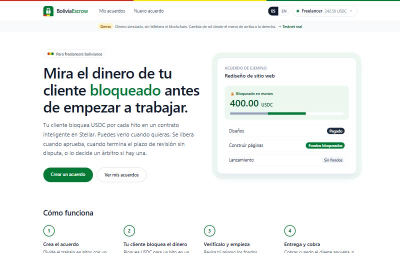
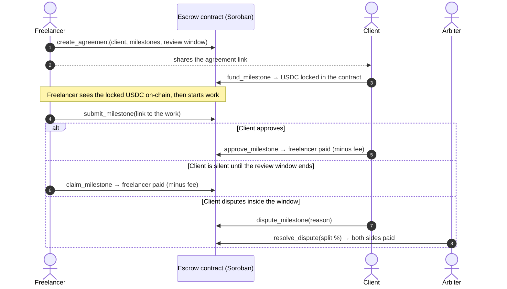
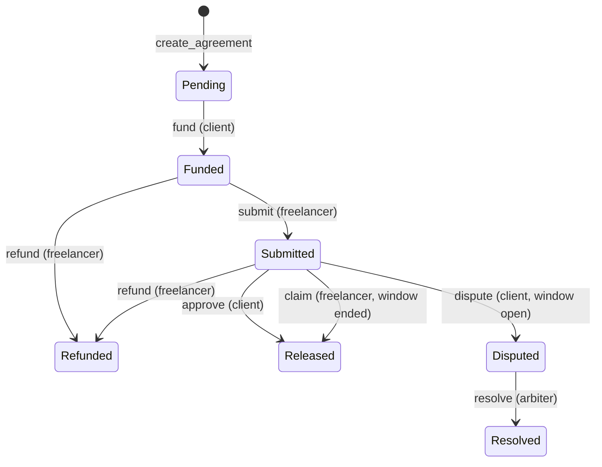
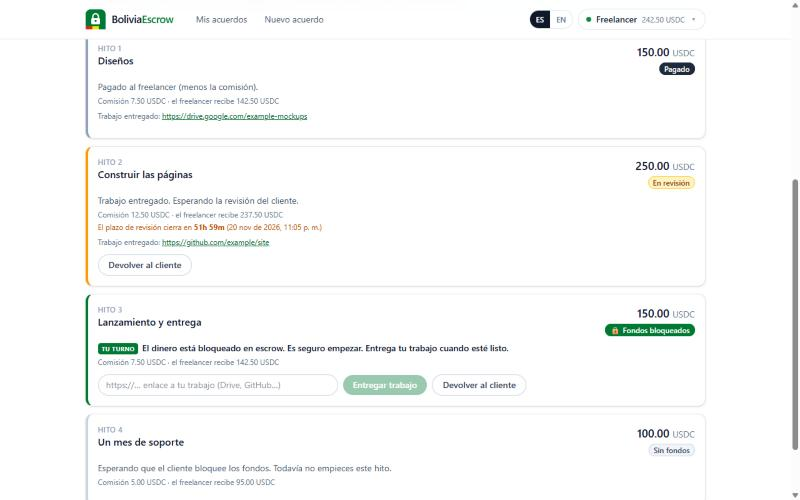
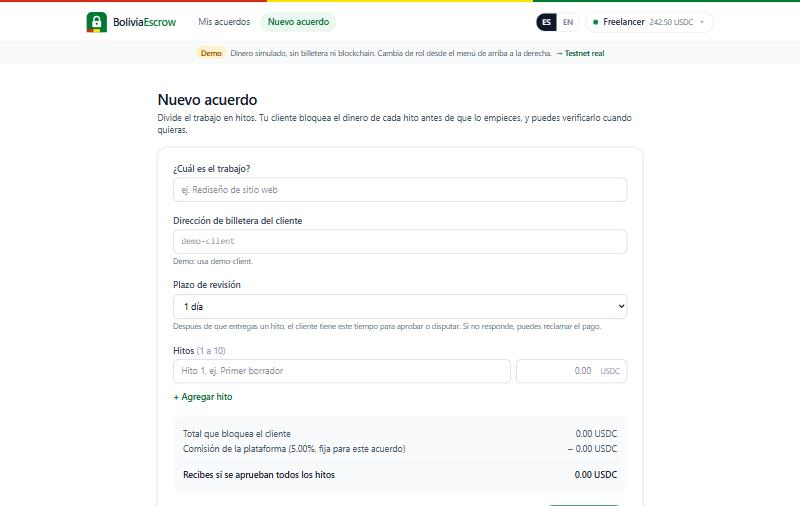
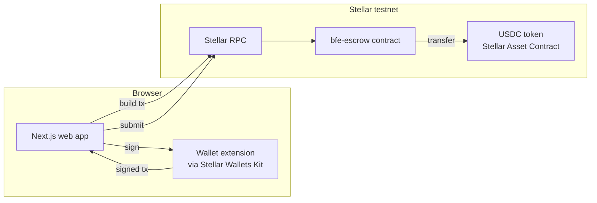

<div align="center">

# 🔒 Bolivia Freelance Escrow

**See your client's money locked before you start working.**

Milestone escrow on **Stellar** for Bolivian freelancers who already have their own clients.
The client locks USDC in a **Soroban smart contract**; the freelancer can verify it on-chain at any time.

`Stellar` · `Soroban` · `Rust` · `Next.js` · `TypeScript` · `Tailwind CSS`

<sub>National Startups Hackathon 2026 by Stellar (Bolivia) · **Live on Stellar testnet** · UI in Spanish 🇧🇴 and English</sub>

</div>



---

## Contents

- [The problem](#the-problem)
- [The solution](#the-solution)
- [How it works](#how-it-works)
- [Why Stellar is the core, not decoration](#why-stellar-is-the-core-not-decoration)
- [Screenshots](#screenshots)
- [Architecture](#architecture)
- [The smart contract](#the-smart-contract)
- [Live on Stellar testnet](#live-on-stellar-testnet)
- [Try it in 2 minutes](#try-it-in-2-minutes)
- [Deploy your own](#deploy-your-own)
- [Project status](#project-status)
- [Roadmap](#roadmap)
- [Repository layout](#repository-layout)
- [Documentation](#documentation)

---

## The problem

Bolivian freelancers who work for clients at home or abroad face three problems:

1. **They can't see the money.** Work starts with no proof that the client can pay.
2. **They depend on goodwill.** Getting paid depends on the client's honesty, or on a
   platform's internal rules that the freelancer can't check.
3. **They pay for a service they don't use.** Marketplace fees pay for finding the client.
   A freelancer who brought their own client still pays that fee.

Context: Bolivia's fixed exchange rate (Bs 6.96) ended in June 2026, inflation was 20.40% in
2025, and virtual assets have been legal since 2024 (BCB RD 082/2024). Being paid in a
dollar stablecoin matters to Bolivians.

## The solution

| | |
|---|---|
| 📝 **Agreement with milestones** | The freelancer splits the job into 1 to 10 milestones, each with an amount. |
| 🔒 **Money locked per milestone** | The client locks USDC for a milestone in a public smart contract before work starts. |
| 👀 **Visible on-chain** | The freelancer sees the locked amount, and can check it on a block explorer. |
| ✅ **Fair release rules** | Paid when the client approves, **automatically claimable** if the client stays silent after the review window, or split by an arbiter after a dispute. |
| 🧾 **Fee fixed up front** | A 5% platform fee is shown before the agreement is created and frozen into it. |

It is **not a marketplace**: no job search, bidding or profiles. Freelancers bring their own clients.

## How it works



Each milestone follows this state machine, enforced by the contract:



**Rules that protect both sides**

- Once money is locked, the **client can never pull it back alone**. Only the freelancer can refund.
- The client can dispute only **inside the review window**, so silence can't block payment forever.
- The fee is a **snapshot per agreement**. Later config changes never touch existing agreements.
- No admin function can move an existing agreement's money or change its terms.

## Why Stellar is the core, not decoration

With a normal database, the platform holds the client's money and both parties must trust the
platform. With a Soroban contract, the money sits in a **public contract whose rules nobody can
change after the agreement is created**, not even us. The freelancer can open a block explorer
and see the locked USDC. The "see the money, trust the process" promise only exists because of
the chain. USDC settlement on Stellar is fast and cheap, which keeps the fee small.

| Hackathon pillar | How this project meets it |
|---|---|
| Use Stellar | The escrow contract holds and releases the money; USDC on Stellar is the payment asset |
| Integrate the ecosystem | Stellar Wallets Kit (Freighter/Varial, xBull, Albedo, LOBSTR, Hana, Rabet), Stellar SDK generated contract bindings, Friendbot; Pollar for a bolivianos on/off-ramp (under evaluation) |
| Solve something real | Freelancers with their own clients, a real and growing group in Bolivia |
| Reach funding | Fee-based model with a clear path from testnet to mainnet |

## Screenshots

| Agreement: money locked, per-milestone status | Milestones: whose turn it is, live review countdown |
|---|---|
|  |  |

| Dashboard | New agreement with fee preview |
|---|---|
|  |  |

| Real agreement read from the testnet contract |
|---|
|  |

<sub>The first four screenshots use demo data; the last one shows agreement #1 read live from the deployed contract.</sub>

## Architecture



- **No backend, no database.** Every agreement, milestone and index lives in the contract.
  The dashboard lists a user's agreements from on-chain indexes (`agreements_of_freelancer`,
  `agreements_of_client`).
- **The app never holds keys or money.** The wallet signs; the contract holds the funds.
- **Two modes, one interface.** Both implement `EscrowApi` (`frontend/src/lib/escrow.ts`):
  - **Testnet** (`lib/escrowReal.ts`): calls the deployed contract through TypeScript bindings generated
    by `stellar contract bindings typescript`; every write is signed in the user's wallet via Stellar Wallets Kit.
  - **Demo**: a faithful in-browser simulation (same state machine and money math) so anyone can click
    through the full flow with no wallet. Visitors switch modes from the banner.
- **Test-money onboarding.** In testnet mode the wallet menu gets a new account ready in three clicks:
  test XLM from Friendbot, a USDC trustline (one signature), and 1,000 test USDC from the app's faucet
  (`app/api/faucet`, server-side, testnet only).

## The smart contract

`contracts/escrow` · Rust · `soroban-sdk` 28.0.0

| Function | Who signs | What it does |
|---|---|---|
| `initialize(admin, arbiter, token, fee_bps, fee_recipient)` | admin | One-time setup |
| `update_config(fee_bps, fee_recipient, arbiter)` | admin | Changes config for **future** agreements only |
| `create_agreement(freelancer, client, title, milestones, review_window_secs)` | freelancer | Creates the agreement, snapshots the fee |
| `fund_milestone(id, index)` | client | Transfers the milestone's USDC into the contract |
| `submit_milestone(id, index, evidence)` | freelancer | Stores a link to the work, starts the review window |
| `approve_milestone(id, index)` | client | Pays the freelancer (minus fee) |
| `claim_milestone(id, index)` | freelancer | Pays the freelancer after the review window ends |
| `dispute_milestone(id, index, reason)` | client | Freezes the milestone for the arbiter, inside the window |
| `resolve_dispute(id, index, freelancer_bps)` | arbiter | Splits the amount between both sides |
| `refund_milestone(id, index)` | freelancer | Returns the full amount to the client |
| `get_config`, `get_agreement`, `agreements_of_freelancer`, `agreements_of_client` | none | Read-only |

**Money math** is integer-only, rounds down and multiplies before dividing:
`fee = amount × fee_bps / 10 000`; the freelancer receives `amount − fee` (5% today). In a dispute split,
the fee applies only to the freelancer's part.

**Invariant (tested):** the contract's USDC balance always equals the sum of all milestones in
status Funded, Submitted or Disputed.

**Quality:** 20 unit tests covering the full state machine, exact balances, fee snapshot,
review window edges, dispute split, arbiter-only auth and the balance invariant.
`cargo clippy -D warnings` clean. Optimized wasm is about 18.7 KB. One event is emitted per state change.

Full spec: [`docs/03_CONTRACT_SPEC.md`](docs/03_CONTRACT_SPEC.md).

## Live on Stellar testnet

| | |
|---|---|
| Escrow contract | [`CDG4IJBASV35CIFBJ66O6HGCV3VWCLDKHCHAXS2QZFLXRKGP4LRNW2LO`](https://stellar.expert/explorer/testnet/contract/CDG4IJBASV35CIFBJ66O6HGCV3VWCLDKHCHAXS2QZFLXRKGP4LRNW2LO) |
| Test USDC (Stellar Asset Contract) | [`CAHWJDBZVQCKB3J5PLBQKJJJLG4BDYANSK4JTAMS2TYEKWRLQZFYDXR2`](https://stellar.expert/explorer/testnet/contract/CAHWJDBZVQCKB3J5PLBQKJJJLG4BDYANSK4JTAMS2TYEKWRLQZFYDXR2) |
| Platform fee | 5% (500 bps), snapshotted per agreement |
| All ids | [`deployments/testnet.json`](deployments/testnet.json) |

**On-chain smoke test** (`scripts/smoke-testnet.sh`): the client locked 100 test USDC
([fund tx](https://stellar.expert/explorer/testnet/tx/e662fa8f39ac084cf8ca0efc32de1ea288a47ea0cffc33049ed2f7554d9cad81)),
the freelancer submitted, the client approved, and the contract paid **95 USDC to the freelancer and a 5 USDC fee**
([approve tx](https://stellar.expert/explorer/testnet/tx/ebc36775d597b210d0abd29ec1a6b057928ac0caa52c571f3971261ca795c37a)).

> Test USDC is our own asset issued on testnet (decision D-04): free, no real value, and we can hand
> balances to testers instantly. On mainnet the contract would be initialized with Circle's USDC instead,
> with no code change.

## Try it in 2 minutes

**Requirements:** Node.js 20+ (and Rust + Stellar CLI only if you want to build the contract).

```bash
git clone https://github.com/JulioGB01/bolivian_freelancer_platform.git
cd bolivian_freelancer_platform/frontend
npm install
npm run dev
```

Open http://localhost:3000 (Spanish by default; **ES / EN** toggle at the top). The app starts in
**demo mode**, so you don't need a wallet. Use the menu at the top right to act as **Freelancer**,
**Client** or **Arbiter**:

1. As **Freelancer**: *New agreement* → add milestones → pick the **1 minute** review window → create.
2. Switch to **Client**: click **Lock … USDC** on a milestone. The locked panel turns green.
3. Switch to **Freelancer**: paste a link to the work → **Submit work**.
4. Either switch to **Client** and **Approve & release**, or wait for the countdown and **Claim**.
5. To test a dispute, **Open dispute** as the Client, then switch to **Arbiter** → *Disputes* → split.

The step-by-step script is in [`docs/DEMO_SCRIPT.md`](docs/DEMO_SCRIPT.md).

**With a real wallet (testnet).** Click **→ Testnet real** in the banner, then:

1. Install [Freighter](https://www.freighter.app/) (listed as *Varial*) or another supported wallet and switch it to **Testnet**.
2. **Conectar billetera** → pick your wallet.
3. In the wallet menu: **Recibir XLM de prueba** → **Activar USDC** (one signature) → **Recibir 1.000 USDC de prueba**.
4. Use two accounts (freelancer and client) and run the same flow. Every action opens your wallet to sign,
   and each confirmation links to the transaction on the explorer.

**Contract tests**

```bash
cd contracts
cargo test          # 20 tests
stellar contract build
```

> On Windows, keep the working copy outside Google Drive or OneDrive. Sync tools break
> `node_modules` and `target/` (see [`docs/10_SETUP.md`](docs/10_SETUP.md)).

## Deploy your own

1. **Contract:** create the identities `bfe-admin`, `bfe-arbiter`, `bfe-treasury`, `bfe-freelancer`, `bfe-client`
   (`stellar keys generate <name> --fund --network testnet`), then run `scripts/deploy-testnet.sh`.
   It builds the wasm, creates the test USDC, deploys and initializes the escrow (5% fee), and writes
   `deployments/testnet.json`. Regenerate the bindings into `frontend/src/contracts/escrow` with
   `stellar contract bindings typescript --network testnet --contract-id <id> --output-dir <dir>`.
2. **Web app on Vercel:** import the repository and set **Root Directory = `frontend`**.
   Optional env vars: `NEXT_PUBLIC_DEFAULT_MODE=testnet` (start in testnet mode),
   `NEXT_PUBLIC_ESCROW_CONTRACT_ID` / `NEXT_PUBLIC_USDC_CONTRACT_ID` / `NEXT_PUBLIC_USDC_ISSUER` (another deployment),
   and `FAUCET_SECRET` = the test-USDC issuer's **testnet** secret, which enables the 1,000 test USDC button.
   Never put a mainnet key there.

## Project status

| Part | Status |
|---|---|
| Soroban escrow contract | ✅ Implemented, 20/20 tests pass, wasm builds |
| Web app in demo mode | ✅ Every screen and flow, responsive |
| Testnet deployment (5% fee, own test USDC) | ✅ Live, smoke-tested on-chain |
| Real wallet mode (Stellar Wallets Kit + generated bindings) | ✅ Reads and writes against the deployed contract |
| Test-money onboarding (Friendbot, trustline, faucet) | ✅ |
| Spanish UI (default) + English | ✅ |
| CI (contract fmt/clippy/tests, frontend lint/build) | ✅ GitHub Actions |
| Public URL | ⏳ Vercel |
| Bolivianos on/off-ramp (Pollar) | 🔍 Under evaluation |

## Roadmap

1. Public URL on Vercel and a 2 to 3 minute demo video.
2. Pollar integration so clients can pay and freelancers can cash out in bolivianos.
3. Interviews with freelancers and clients, a legal review (ASFI fintech licence categories),
   then mainnet.

## Repository layout

```
contracts/escrow/      Soroban contract (Rust): lib.rs, types.rs, errors.rs, events.rs, test.rs
frontend/              Next.js app
  src/app/             pages: home, dashboard, new agreement, agreement detail, disputes
  src/components/      milestone row, money-locked panel, wallet menu, …
  src/lib/             escrow API (demo + testnet), wallet kit, i18n (es/en), status rules
  src/contracts/       generated contract bindings (do not edit)
  src/app/api/faucet   test-USDC faucet (testnet only)
deployments/           deployed contract ids (testnet)
docs/                  product, architecture, contract spec, test plan, decisions, demo script
scripts/               checks, secret scan, testnet deploy and smoke test
```

## Documentation

| Doc | Content |
|---|---|
| [`00_THINKING.md`](docs/00_THINKING.md) | Why the product is shaped this way |
| [`01_PRODUCT_SPEC.md`](docs/01_PRODUCT_SPEC.md) | Users, user stories, flows |
| [`02_ARCHITECTURE.md`](docs/02_ARCHITECTURE.md) | Components and data flow |
| [`03_CONTRACT_SPEC.md`](docs/03_CONTRACT_SPEC.md) | Contract functions, storage, money math, security |
| [`04_FRONTEND_SPEC.md`](docs/04_FRONTEND_SPEC.md) | Screens and behaviour rules |
| [`09_TEST_PLAN.md`](docs/09_TEST_PLAN.md) | What the tests cover |
| [`07_DECISIONS.md`](docs/07_DECISIONS.md) | Decisions made and still open |

---

<div align="center">
<sub>Made for Bolivian freelancers 🇧🇴 · Built on Stellar</sub>
</div>
