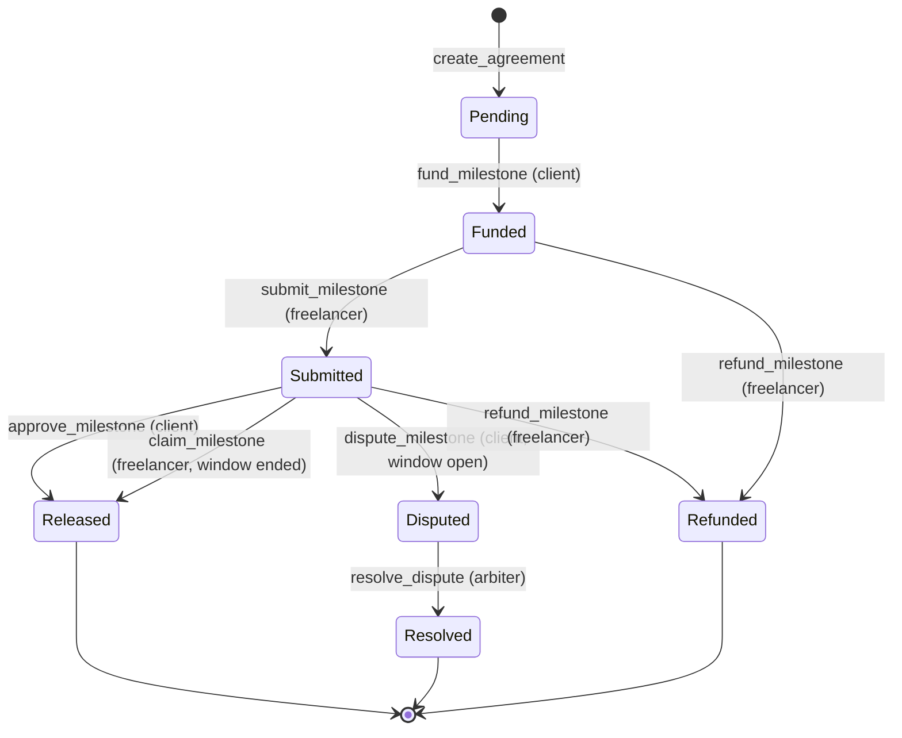

# 03 - Contract Spec: `bfe-escrow`

Language: Rust, `soroban-sdk` 28.0.0 (same version as the local `soroban-examples`, decision D-08). Source: `contracts/escrow/src/`.

## 1. Milestone state machine

Any call on a milestone in a status not shown as the arrow's source fails with `InvalidStatus`.

## 2. Storage

| Key | Type | Storage | Written by |
|---|---|---|---|
| `Config` | `Config` | instance | `initialize`, `update_config` |
| `NextId` | `u64` | instance | `create_agreement` (starts at 0) |
| `Agreement(id)` | `Agreement` | persistent | every lifecycle function |
| `ByFreelancer(addr)` | `Vec<u64>` | persistent | `create_agreement` |
| `ByClient(addr)` | `Vec<u64>` | persistent | `create_agreement` |

TTL: extend instance storage on every call and the touched persistent entries on every write, following `soroban-examples/ttl`. Threshold and extend-to values are decision D-07.

## 3. Functions

Amounts are `i128` in the token's smallest unit. Time is the ledger timestamp in seconds (`env.ledger().timestamp()`).

| Function | Auth | Preconditions | Effects | Errors |
|---|---|---|---|---|
| `initialize(admin, arbiter, token, fee_bps, fee_recipient)` | admin | not initialized; `fee_bps <= 10_000` | store Config, NextId = 0 | AlreadyInitialized, InvalidBps |
| `update_config(fee_bps, fee_recipient, arbiter)` | Config.admin | initialized; `fee_bps <= 10_000` | overwrite those fields; existing agreements unchanged | NotInitialized, InvalidBps |
| `create_agreement(freelancer, client, title, milestones, review_window_secs) -> u64` | freelancer | initialized; `freelancer != client`; `1 <= len <= MAX_MILESTONES`; every amount > 0 | new Agreement with id = NextId, all milestones Pending, `fee_bps` copied from Config, `created_at` = now; push id to both indexes; NextId += 1 | NotInitialized, SameParty, InvalidMilestoneCount, InvalidAmount |
| `fund_milestone(agreement_id, index)` | client | status Pending | token.transfer(client -> contract, amount); status Funded | AgreementNotFound, MilestoneNotFound, InvalidStatus |
| `submit_milestone(agreement_id, index, evidence)` | freelancer | status Funded | evidence stored; `submitted_at` = now; status Submitted | same |
| `approve_milestone(agreement_id, index)` | client | status Submitted | payout (section 4); status Released | same |
| `claim_milestone(agreement_id, index)` | freelancer | status Submitted; `now >= submitted_at + review_window_secs` | payout; status Released | same + ReviewWindowOpen |
| `dispute_milestone(agreement_id, index, reason)` | client | status Submitted; `now < submitted_at + review_window_secs` | reason stored; status Disputed | same + ReviewWindowClosed |
| `resolve_dispute(agreement_id, index, freelancer_bps)` | Config.arbiter | status Disputed; `freelancer_bps <= 10_000` | split (section 4); status Resolved | same + InvalidBps |
| `refund_milestone(agreement_id, index)` | freelancer | status Funded or Submitted | token.transfer(contract -> client, amount); status Refunded | same |
| `get_config()` | none | initialized | returns Config | NotInitialized |
| `get_agreement(id)` | none | exists | returns Agreement | AgreementNotFound |
| `agreements_of_freelancer(addr)` | none | none | ids, empty Vec if none | none |
| `agreements_of_client(addr)` | none | none | ids, empty Vec if none | none |

## 4. Money math

Integer arithmetic only, rounding down, all multiplications before divisions:

- Payout on Released: `fee = amount * fee_bps / 10_000`; freelancer receives `amount - fee`; `fee_recipient` receives `fee`. Skip a transfer when its value is 0.
- Split on Resolved: `freelancer_part = amount * freelancer_bps / 10_000`; `client_part = amount - freelancer_part`; `fee = freelancer_part * fee_bps / 10_000`; freelancer receives `freelancer_part - fee`; fee_recipient receives `fee`; client receives `client_part`.
- `fee_bps` used is always the agreement's snapshot, never the current Config.

**Invariant:** the contract's token balance equals the sum of `amount` over all milestones in status Funded, Submitted or Disputed, across all agreements. Tested in T1.11.

## 5. Events

Emit one event per state change: `created`, `funded`, `submitted`, `approved`, `claimed`, `disputed`, `resolved`, `refunded`, each with the agreement id and milestone index. Use the event API of the SDK version in use; copy the pattern from `soroban-examples/events`.

## 6. Security checklist

- `require_auth` on the correct address in every state-changing function (table, section 3).
- State updated before outgoing token transfers.
- No function lets the client move locked money back to themselves.
- No admin function can touch an existing agreement's money or terms.
- Overflow checks are on in the release profile (`overflow-checks = true`).
