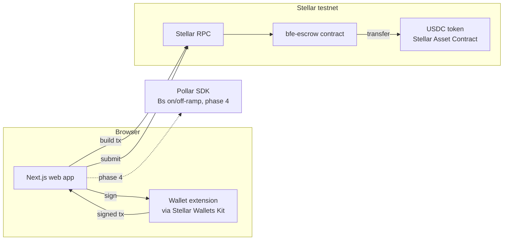

# Architecture

## Components

## Responsibilities

| Component | Does | Does not |
|---|---|---|
| `bfe-escrow` contract | Store agreements and milestones, hold USDC, enforce who can do what and when, pay out with fee | Know anything about bolivianos, users' names or files |
| USDC token | Standard token transfers | Escrow logic |
| Web app | Show state read from the contract, build and submit transactions, generated TypeScript client | Hold keys, hold money, store data of its own |
| Wallet | Hold the user's key and sign | Anything else |
| Pollar (phase 4) | Bolivianos to/from USDC | Escrow |

## Data

All product data lives in the contract (see [`contract.md`](contract.md)):

- Instance storage: `Config`, `NextId`.
- Persistent storage: `Agreement(id)`, `ByFreelancer(address)`, `ByClient(address)`.

No database and no backend in the MVP. Evidence of work is a link (for example a Google Drive or GitHub URL) stored as a string.

## Network

Testnet only. Network passphrase, RPC URL and contract ids come from environment variables (`.env.example`) and `deployments/testnet.json`. Values must be taken from the Stellar CLI's network config or official Stellar docs, never typed from memory.

## Repository layout

See the repository layout in the [README](../README.md#repository-layout).
