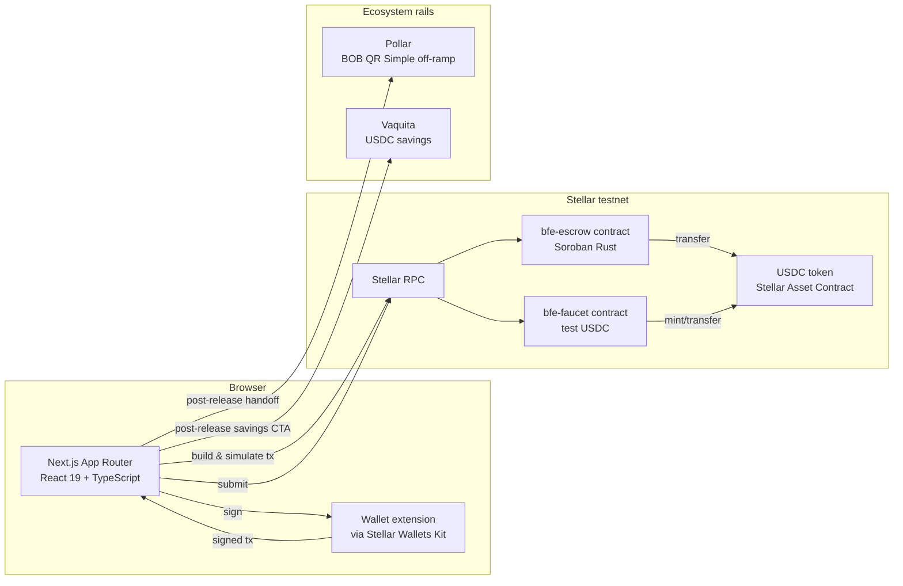

# Architecture

## Components

## Responsibilities

| Component | Does | Does not |
|---|---|---|
| `bfe-escrow` contract | Store agreements and milestones, hold USDC non-custodially, freeze `fee_bps` (1.5%), `arbiter`, and `fee_recipient` per agreement, enforce state transitions (including anti-ghosting `Funded -> Disputed`), pay out with fee, emit events | Know anything about bolivianos, users' names, or files |
| `bfe-faucet` contract | Dispense 1,000 test USDC per address every 24h on Testnet | Run on Mainnet |
| USDC token (SAC) | Standard Stellar Asset Contract transfers | Escrow logic |
| Web app (`src/`) | Read on-chain state & events, build/submit transactions via generated TypeScript bindings, run local Demo mode, render Pollar/Vaquita post-release flows and printable SIAT payment receipts | Hold keys, custody user funds, or run a centralized database |
| Wallet | Hold the user's private key and sign transactions | Anything else |
| Pollar | Convert USDC ↔ BOB via Bolivian QR Simple under regulated rails | Escrow custody |
| Vaquita | Optional USDC yield/savings for freelancers after payout | Escrow custody |

## Data

All product data lives on-chain in the Soroban contract (see [`contract.md`](contract.md)):

- **Instance storage** (~30-day TTL): `Config`, `NextId` (readable via `get_next_id()` for gap-safe pagination).
- **Persistent storage** (~30-day TTL, extended on every write): `Agreement(id)`, `ByFreelancer(address)`, `ByClient(address)`.

No database and no backend in the MVP. Evidence of work is a URL link (for example a Google Drive or GitHub URL, bounded to 512 chars) stored on-chain.

## Dual Runtime Mode

- **Demo mode (`demo`):** Default mode backed by `MockEscrow` in `localStorage` (`src/lib/escrow.ts`), mirroring the hardened contract rules (1.5% default fee, `Funded -> Disputed` anti-ghosting, `resolvedFreelancerBps`, demo client balance top-up).
- **Testnet mode (`testnet`):** Connects to Stellar Testnet RPC via `src/lib/escrowReal.ts` and Stellar Wallets Kit (`src/lib/wallet.ts`), respecting `NEXT_PUBLIC_NETWORK_PASSPHRASE`.

## Network

Testnet for the hackathon MVP. Network passphrase, RPC URL, and contract IDs come from environment variables (`.env.example`) and `deployments/testnet.json`. Values are sourced from the Stellar CLI's network config or official Stellar docs, never hardcoded.

## Repository layout

See the repository layout in the [README](../README.md#repository-layout).
