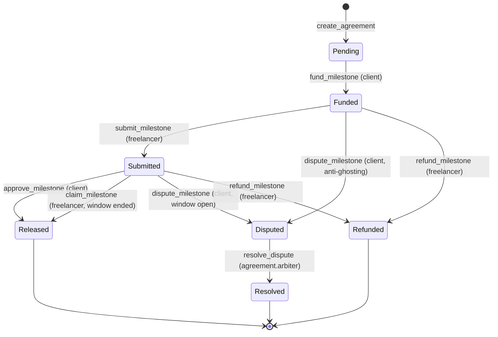

# Contract: `bfe-escrow`

Language: Rust, `soroban-sdk` 28.0.0. Source: `contracts/escrow/src/`.

## 1. Milestone state machine

Any call on a milestone in a status not shown as the arrow's source fails with `InvalidStatus`.

## 2. Storage & TTL

| Key | Type | Storage | Written by |
|---|---|---|---|
| `Config` | `Config` | instance | `initialize`, `update_config` |
| `NextId` | `u64` | instance | `create_agreement` (starts at 0; read via `get_next_id`) |
| `Agreement(id)` | `Agreement` | persistent | every lifecycle mutation |
| `ByFreelancer(addr)` | `Vec<u64>` | persistent | `create_agreement` |
| `ByClient(addr)` | `Vec<u64>` | persistent | `create_agreement` |

**Storage TTL (~30 days):**
- `INSTANCE_TTL_THRESHOLD = 172_800` ledgers (~10 days at ~5s/ledger), `INSTANCE_TTL_EXTEND_TO = 518_400` ledgers (~30 days).
- `PERSISTENT_TTL_THRESHOLD = 172_800` ledgers (~10 days), `PERSISTENT_TTL_EXTEND_TO = 518_400` ledgers (~30 days).
- Instance storage TTL and touched persistent entries (`Agreement(id)`, `ByFreelancer`, `ByClient`) are extended on every state-changing write. Read-only getters do not call TTL extensions.

**Per-agreement immutable snapshots:**
At `create_agreement`, the contract copies `fee_bps` (default **150 bps = 1.5%**), `arbiter`, and `fee_recipient` from `Config` directly into the `Agreement` struct. Calling `update_config` later only affects **future** agreements and can never hijack an active dispute or redirect fees on an existing agreement.

**Milestone fields & bounds:**
- `Milestone` stores `resolved_freelancer_bps: Option<u32>` (set to `Some(freelancer_bps)` in `resolve_dispute`) so on-chain stats and profiles accurately credit disputed payouts.
- Review window bounds: `MIN_REVIEW_WINDOW_SECS = 3_600` (1 hour) to `MAX_REVIEW_WINDOW_SECS = 2_592_000` (30 days), preventing 0-second rug-pulls and indefinite locks.
- String length bounds: agreement `title <= 160` bytes, milestone description/title `<= 240` bytes, `evidence <= 512` bytes.

## 3. Functions

Amounts are `i128` in the token's smallest unit (7 decimals for Stellar USDC). Time is the ledger timestamp in seconds (`env.ledger().timestamp()`).

| Function | Auth | Preconditions | Effects | Errors |
|---|---|---|---|---|
| `initialize(admin, arbiter, token, fee_bps, fee_recipient)` | admin | not initialized; `fee_bps <= 10_000` (default `150` = 1.5%) | store Config, NextId = 0 | AlreadyInitialized, InvalidBps |
| `update_config(fee_bps, fee_recipient, arbiter)` | Config.admin | initialized; `fee_bps <= 10_000` | overwrite those fields for **future** agreements only; existing agreements keep their frozen snapshots | NotInitialized, InvalidBps |
| `create_agreement(freelancer, client, title, milestones, review_window_secs) -> u64` | freelancer | initialized; `freelancer != client`; `1 <= len <= MAX_MILESTONES`; every `amount > 0`; `3_600 <= review_window_secs <= 2_592_000`; bounded string lengths | new Agreement with `id = NextId`, all milestones `Pending`, `fee_bps`, `arbiter`, and `fee_recipient` snapshotted from `Config`, `created_at = now`; push id to both indexes; `NextId += 1` | NotInitialized, SameParty, InvalidMilestoneCount, InvalidAmount, InvalidReviewWindow, StringTooLong |
| `fund_milestone(agreement_id, index)` | agreement.client | status `Pending` | `token.transfer(client -> contract, amount)`; status `Funded` | AgreementNotFound, MilestoneNotFound, InvalidStatus |
| `submit_milestone(agreement_id, index, evidence)` | agreement.freelancer | status `Funded`; `evidence.len() <= 512` | evidence stored; `submitted_at = now`; status `Submitted` | same + StringTooLong |
| `approve_milestone(agreement_id, index)` | agreement.client | status `Submitted` | payout (section 4); status `Released` | same |
| `claim_milestone(agreement_id, index)` | agreement.freelancer | status `Submitted`; `now >= submitted_at + review_window_secs` | payout (section 4); status `Released` | same + ReviewWindowOpen |
| `dispute_milestone(agreement_id, index, reason)` | agreement.client | status `Funded` (anti-ghosting) **or** (status `Submitted` and `now < submitted_at + review_window_secs`) | reason stored; status `Disputed` | same + ReviewWindowClosed |
| `resolve_dispute(agreement_id, index, freelancer_bps)` | **agreement.arbiter** (frozen snapshot) | status `Disputed`; `freelancer_bps <= 10_000` | split (section 4); store `resolved_freelancer_bps = Some(freelancer_bps)`; status `Resolved` | same + InvalidBps |
| `refund_milestone(agreement_id, index)` | agreement.freelancer | status `Funded` or `Submitted` | `token.transfer(contract -> client, amount)`; status `Refunded` (0% fee) | same |
| `get_config()` | none | initialized | returns `Config` | NotInitialized |
| `get_next_id()` | none | initialized | returns `NextId` (`u64`) for gap-safe pagination | NotInitialized |
| `get_agreement(id)` | none | exists | returns `Agreement` | AgreementNotFound |
| `agreements_of_freelancer(addr)` | none | none | ids, empty Vec if none | none |
| `agreements_of_client(addr)` | none | none | ids, empty Vec if none | none |

## 4. Money math

Integer arithmetic only, rounding down, all multiplications before divisions:

- **Payout on `Released`:** `fee = amount * fee_bps / 10_000`; freelancer receives `amount - fee`; `agreement.fee_recipient` receives `fee`. Skip a transfer when its value is 0.
- **Split on `Resolved`:** `freelancer_part = amount * freelancer_bps / 10_000`; `client_part = amount - freelancer_part`; `fee = freelancer_part * fee_bps / 10_000`; freelancer receives `freelancer_part - fee`; `agreement.fee_recipient` receives `fee`; client receives `client_part`.
- `fee_bps`, `arbiter`, and `fee_recipient` used are always the **agreement's frozen snapshots**, never the live `Config`.

At the default **1.5% (`150 bps`)** fee, releasing a 100.00 USDC milestone pays **98.50 USDC** to the freelancer and **1.50 USDC** to `agreement.fee_recipient`.

**Invariant:** the contract's token balance equals the sum of `amount` over all milestones in status `Funded`, `Submitted`, or `Disputed`, across all agreements. Covered by a unit test.

## 5. Events

Emit one event per state change: `created`, `funded`, `submitted`, `approved`, `claimed`, `disputed`, `resolved` (including `freelancer_bps`), and `refunded`, each with the agreement id and milestone index.

## 6. Security checklist

- `require_auth` on the correct address in every state-changing function (table, section 3).
- `arbiter`, `fee_recipient`, and `fee_bps` are snapshotted per agreement — `update_config` can never alter active agreements.
- Anti-ghosting protection: clients can dispute a `Funded` milestone so funds can never be permanently trapped if a freelancer disappears.
- Review window bounded between 1 hour and 30 days (`3_600..=2_592_000` seconds) to prevent 0-second rug-pulls.
- State updated before outgoing token transfers.
- No function lets the client unilaterally withdraw locked funds; no admin function can touch an existing agreement's money or terms.
- Overflow checks are enabled in the release profile (`overflow-checks = true`).
